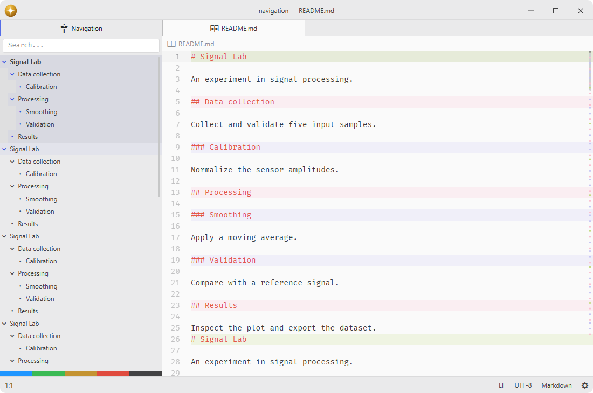

# scrollmap

Show markers on the scrollbar.

A strip inside every editor scrollbar drawing the layers the `marker` package computes — git changes, linter messages, search hits and more — plus the same widget for custom panes.

## Features

- **Layer system**: marker layers enabled in the `marker` hub are drawn underneath the scrollbar thumb, computed once and shared with the minimap.
- **Visibility**: show or hide editor scrollbar markers while preserving the shared layers and their state.
- **Column layout**: markers positioned in the left, center, or right column, or spanning the full width.
- **Cross-platform**: shares the editor's overlay scrollbar geometry on Windows, macOS, and Linux.
- **Simplemap API**: support for non-editor panes like the PDF view.



## Installation

To install `scrollmap` search for it in the Install pane of the Lumine settings, or run the command `lumine --install lumine-code/scrollmap`.

## Commands

Commands available in `lumine-workspace`:

- `scrollmap:toggle`: show or hide the marker strips on editor scrollbars.

## Customization

The core scrollbar owns the track width and viewport geometry. Every marker strip uses its own scroller, so resizing or selecting another pane never changes an unrelated strip.

Markers are drawn on a canvas for performance. Existing marker CSS classes are still used through hidden style resolver elements, so packages and user styles can keep setting marker color, opacity, width, height, and z-index with `.marker` rules.

Marker widths use percentages (40% center, 20% sides) to scale proportionally across platforms.

The style can be adjusted according to user preferences in the `styles.css` file, e.g. change marker width and opacity or style specific layers:

```css
.scrollmap .marker {
  width: 6px;
  opacity: 0.8;
}

.scrollmap .marker-mylayer {
  background-color: var(--accent-indicator-color);
}
```

## Services

- `marker.registry`: consumed to read every editor's computed marker layers and the toolkit that draws them.
- [`scrollmap.widget`](docs/scrollmap.widget.md): provided to expose a standalone scrollbar-marker widget class for non-editor panes.

## Contributing

Got ideas to make this package better, found a bug, or want to help add new features? Just drop your thoughts on GitHub. Any feedback is welcome!
